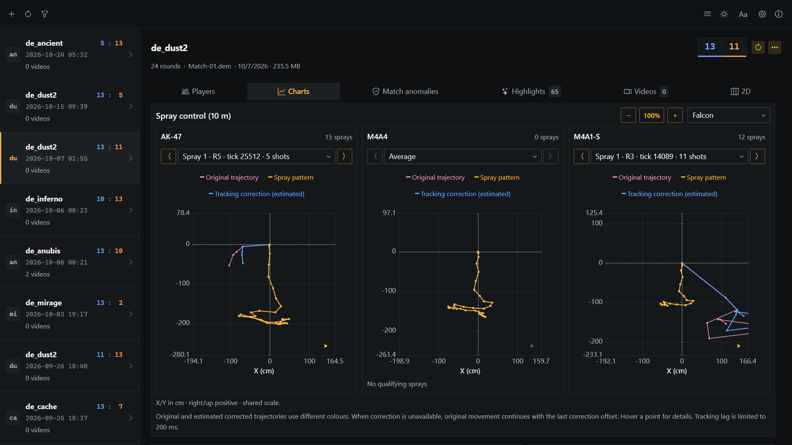
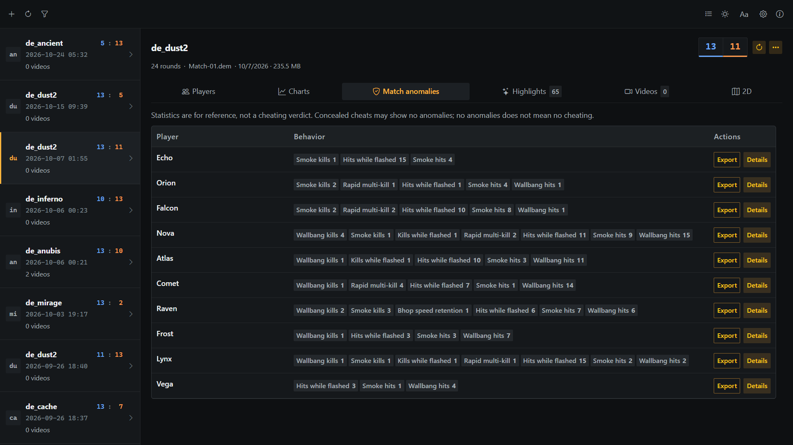
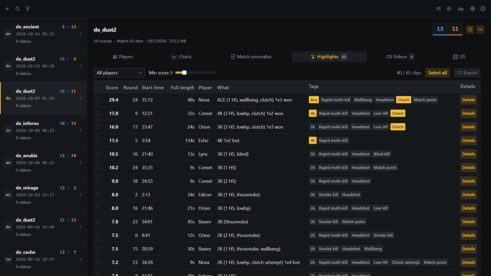
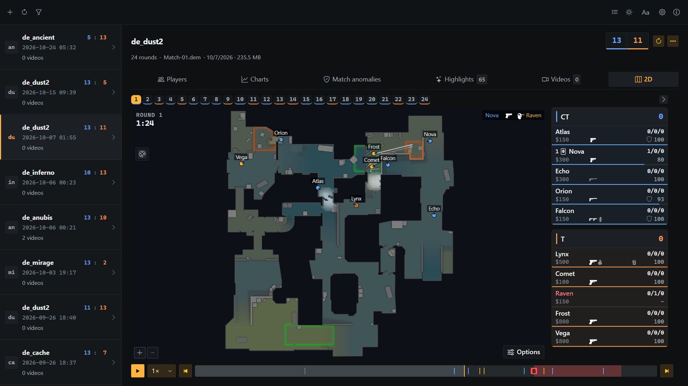

# CS DemoDesk

English | [繁體中文](README.zh-TW.md) | [简体中文](README.zh-CN.md) | [日本語](README.ja.md) | [한국어](README.ko.md) | [Русский](README.ru.md)

A Windows desktop tool for managing and analyzing Counter-Strike 2 demos. Explore player statistics, 2D replays and experimental match anomalies, and export highlights or suspicious moments as videos.

## Download

- **[Microsoft Store](https://apps.microsoft.com/detail/9N5G4VXSDGS5)** — Install and receive updates through Microsoft Store.
- **[Portable EXE](https://github.com/noih/cs-demodesk/releases/latest)** — Download the standalone `.exe` from GitHub Releases; no installation required.

## Before you start

- If export fails after a CS2 update, re-download HLAE from Settings; this usually fixes it.
- You cannot play while recording.
- NVIDIA encoding requires an NVIDIA GPU.

## Features

### Match statistics

Review match results and player performance across combat, utility and round situations. Comparison charts, round trends and spray control plots help explore the match from different angles.



### Anomaly data (experimental)

Analyze aiming, shooting and movement across all players, including TTD and estimated smoke hit rate. Select, merge and export suspicious clips by player and behavior for closer review.

Statistics are for reference, not a cheating verdict. They cannot identify deliberately concealed cheats without statistical anomalies; no anomalies does not mean no cheating.



### Highlight videos

- Highlights (multi-kills, clutches, ninja defuses) are detected and scored automatically
- Selected clips are recorded by CS2 in the background and encoded with FFmpeg
- Customize video resolution and frame rate (FPS)
- Choose AV1 (default), H.264 or H.265, with CPU or NVIDIA GPU encoding
- Choose which on-screen elements to show and optionally merge clips into one video
- Set a file size limit (10 / 20 / 50 / 100 MB) for easy sharing



### 2D replay

- Player positions, view angles, health, armor, weapon, money
- Grenades, smoke / fire / flash areas, C4 and defuse countdowns, kill feed, hearing range
- Round navigation, playback speed, follow a player
- Multi-level maps shown one level per panel; radar images extracted from the local game files



## Design

### Read-only access to game files

Nothing is written into the game folder: no plugin, script, or cfg, and no game file is changed. Recording launches a separate CS2 process through [HLAE](https://github.com/advancedfx/advancedfx) with `-insecure` (the same as using HLAE manually), sends commands over the game's own netcon console, and keeps game settings in a separate `USRLOCALCSGO` folder so the player's settings are untouched. All third-party tools are downloaded into the app's own data folder:

| Tool | Purpose | Source |
| --- | --- | --- |
| HLAE | Recording (mirv_streams) | [advancedfx/advancedfx](https://github.com/advancedfx/advancedfx) |
| FFmpeg | Encoding, merging, size limit | [noih/cs-demodesk-ffmpeg](https://github.com/noih/cs-demodesk-ffmpeg) (GPL) |
| Source 2 Viewer CLI | Radar image extraction from vpk | [ValveResourceFormat](https://github.com/ValveResourceFormat/ValveResourceFormat) (MIT) |
| FidelityFX CAS | 2D radar image sharpening (adapted implementation) | [GPUOpen-Effects/FidelityFX-CAS](https://github.com/GPUOpen-Effects/FidelityFX-CAS) (MIT) |
| demoparser | Demo parsing (vendored) | [LaihoE/demoparser](https://github.com/LaihoE/demoparser) (MIT) |

DemoDesk uses a minimal custom FFmpeg build based on [BtbN/FFmpeg-Builds](https://github.com/BtbN/FFmpeg-Builds), retaining only the libraries and features the app needs.

### File-based storage

No database is required. Settings, export jobs and analysis caches are stored as files in the user home directory (`%USERPROFILE%\.noih\demodesk-data`) by default; the data folder can be changed in Settings. Clearing that setting restores the default on restart. Existing files are not moved; to reuse an older portable data folder, select it in Settings. Demos stay at their original paths and can be added individually or discovered through scan folders.

## Build

Requires [Rust](https://rustup.rs) (stable) with Visual Studio Build Tools (Desktop development with C++), Node.js 24.20.0 (`.nvmrc`), and WebView2 (included in Windows).

```powershell
npm install
npm run app:dev      # development: Vite + Tauri window
npm run app:build    # dist-portable\CS-DemoDesk-<version>.exe
npm run app:release  # portable EXE + unsigned Store MSIX (Windows SDK required)
npm run test:core    # Rust unit tests
```

## Releases

Releases are built by [GitHub Actions](.github/workflows/release.yml) and include the portable EXE and its SHA256 checksum. The unsigned MSIX and its checksum are available in the workflow run as the `store-msix-<tag>` artifact, retained for 90 days for manual Microsoft Store submission. Both binaries receive build-provenance attestations. To verify that a download was built from this repository:

```powershell
gh attestation verify CS-DemoDesk-<version>.exe --owner noih
```

## License

Copyright (C) 2026 NOIH - <https://github.com/noih>

[GNU AGPL-3.0](LICENSE). Third-party components keep their own licenses (see the table above; the vendored demoparser retains its MIT license in `vendor/demoparser/LICENSE`).
