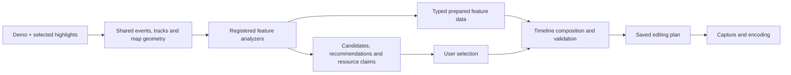

# Editing preview (unreleased)

## Flow

Select highlights, open Export, then choose **Analyze editing opportunities**.
Ordinary export remains available without analysis. Analysis reads the demo and
installed map geometry; it does not launch CS2 or HLAE. Missing geometry is shown
as unavailable opening/team-push analysis, not as evidence that no scene occurred.

The result distinguishes availability from recommendation. Every enemy kill
with a valid victim camera can be selected, including utility and knife kills
and kills below the automatic recommendation threshold. Recommendations retain
the reciprocal gun-combat rule. Camera eligibility, round boundaries, and required playback time still
apply. Utility stories and team pushes are currently selected per highlight;
enemy replays are selected per kill. Conflicting alternatives replace each other.
The UI shows one notice about increased length and quality under a size limit.

Results are grouped into collapsible highlights with a selected/available count.
The first highlight starts expanded. Enemy replays share one heading and use
compact selectable rows; collapsing a highlight preserves its selections.
Highlights without candidates remain visible in a mixed result as unavailable.

Changing highlights or the combat-trimming mode invalidates the current UI
selection. Analysis is cached by version, demo path/size/modification time,
parse generation, selected highlight definitions, and trimming choices. Encoding
settings do not invalidate it. Opening the dialog reads matching cached results
without starting analysis. Analyze again removes the old cache and recomputes it;
a failed recomputation leaves no old result to reload.

Queueing composes a plan from cached feature opportunities and cameras, validates the selection,
and saves `editing-plan.json` beside the job. Export consumes that snapshot without
rerunning event or geometry analysis. Clearing the cache cannot change queued
work. Changed demo input and missing or invalid plans fail explicitly.

## Pipeline ownership

- `render/demo_data.rs` acquires shared facts. `editing/context.rs` loads the demo
  bytes once, parses events, and optionally supplies sampled positions and static
  map geometry. No game process is started. Missing spatial data only disables
  features requiring it.
- `editing/features/mod.rs` is the registration point and `Feature` contract.
  Each feature owns discovery, eligibility, recommendations, its serialized
  prepared data, composition, and validation. Domain calculations remain in the
  corresponding opening, perspectives, utility, and team-push modules, alongside
  their existing camera scheduling adapters.
- Detection resolves utility causality, combat scores and eligibility, living
  intervals for openings, and team-push cameras once. `Composition` has no events,
  parser, file handles, or game tools. It only positions prepared opportunities
  against the evolving timeline; grouping or collision checks at this stage are
  composition, not scene detection.
- `editing.rs` coordinates the registry, resource conflicts, duration estimates,
  feasibility checks, and user selection. It does not compare named feature pairs.
  Features claim an introduction slot or a player's perspective interval. Priority
  chooses the default when those resources overlap; users can choose either.
  Composition also validates individual candidates, pairs, and defaults.
- Compilation phases are explicit: expand coverage, construct stories, insert
  replays, then prepend introductions. Each selected feature validates its result
  after composition, so another edit cannot silently remove it. The renderer's
  clip/camera arrays are checked for alignment at the boundary.
- `engine/editing.rs` owns cache identity, freshness, reanalysis and immutable job
  snapshots. Both interactive and non-interactive requests use the same pipeline.
  Render options for non-interactive requests only select registry entries.

To add a feature, implement its analyzer and `Feature` contract in a new feature
module, register it, and add its typed serialized payload and UI kind/labels.
Declare existing resource claims and the compilation phase it needs. New rule
conditions belong inside that feature; do not add branches to the orchestrator.
A new data source or camera primitive may require extending those shared contracts.
No dynamic plugin framework or generic predicate engine is involved.

This is an unreleased schema replacement. Version 9 invalidates old analysis keys;
there is no reader or conversion for the old events-based cache. Reanalyze to
create new results. Old queued editing jobs also require fresh analysis.

## Utility observer cameras

HE teamwork analysis optionally loads projectile tracks and qualifies an observer
camera against static map geometry. The saved story keeps the thrower's wind-up
and release, then replaces the flight chase and victim POV with one observer shot.
A supporting shooter's shot, when present, remains between those two shots.
The observer lasts at least 1.5 seconds; direct utility deaths retain the shared
0.7-second death hold plus render margin. Missing geometry, incomplete tracks or
no qualified camera preserves the entire original chase/victim sequence. Flash,
fire and unusual utility damage retain their existing presentation.

The selected position, framing, body samples and flight path are saved with the
analysis. Export never repeats the search. A small movement-driven pan is checked
against both bodies and trajectory; when it would crop them, the saved static
framing is used. The underlying spectator target remains alive through the shot,
independently of the victim whose action it shows. This does not suppress CS2's
match-end transition. Static geometry does not model smoke or corpse animation.

## Replay links

Each selected combat replay after the first has a link/unlink toggle beside its
row. The tooltip shows only its current playback state. Recommendations
connect exchanges within the same time cluster (gaps up to three seconds);
users can join or separate adjacent selected exchanges within each highlight.
Removing a selected exchange clears affected links instead of silently connecting
its neighbours. Recommended links initialize the selection; later edits do not
reset manual choices.

The compiler plays a group's main-player action before its enemy replays. A final
linked group retains the original main-player ending before replaying the enemies.
Main-player source intervals are never repeated to fill gaps. An impossible
separation fails validation instead of shortening a view or overriding the link.
The diagram comes from the same compiled plan as export, with timestamps available
on hover. Selection changes only compile cached prepared data; they neither parse
the demo nor launch CS2. Pending or invalid previews block export, and stale
responses cannot replace a newer selection. The saved job snapshot includes the
chosen links and compiled order. Linking does not imply a smooth camera transition.

Regression verification covers 64 selection combinations across three local demo
jobs, comparing candidates, recommendations, conflicts and exact shot plans before
and after the refactor. Synthetic tests cover team push plus combat, competing
introductions, user-selected non-recommended kills, serialized analysis roundtrips,
and missing spatial data. Private demo characterization is opt-in via
`DEMODESK_PIPELINE_JOBS` (semicolon-separated job JSON paths) and
`DEMODESK_PIPELINE_OUTPUT` (a new output directory), then
`cargo test -p demodesk-core --lib characterize_editing_pipeline -- --ignored --nocapture`.

## Opening handoff

An opening adds 1.8 seconds before the unedited recording window's start (after
combat trimming). That entry tick is saved during analysis. The opening must
hand off to the main player's first-person shot at that same tick; utility
rewinds cannot move the entry or use up the opening's duration.

When a utility throw predates the clip, preserve the original main POV up to the
story's return point before rewinding to the throw. For a direct utility kill,
keep the main POV up to the effect. This retains opening gunfire instead of
starting the story with a teammate camera. If composition cannot provide the
original POV handoff, opening and that edit are not offered together.

Opening paths are selected from shoulder offsets using the player's position,
view direction and crouch amount. The planner checks interpolated lens positions,
the approach to first person, a clearance envelope and nearby player bodies
against static map geometry. It rejects blocked or unknown paths instead of
falling back to an unchecked offset. The saved path is reused during recording;
the camera looks into the action ahead and hides the first-person weapon until
the handoff. Static geometry and sampled tracks do not model dynamic doors or
exact animated character meshes, so native visual checks remain necessary.

## Viewpoint pacing

All discrete editing views last at least 1.5 seconds; a shown death retains at
least 0.7 seconds afterward, with a 0.125-second demo-render margin beyond the
event tick. These timings live in `editing/pacing.rs`. Utility
and supporting-shooter views rewind within round bounds to obtain enough lead-in.
An unavailable window is not stretched across the next round. Short main-POV
continuations stay before an enemy replay, avoiding a brief return between edits
and preserving the original action without replaying the protagonist's kill.
Team cameras and POV gaps use the same minimum after clipping to the final plan.
Continuous grenade tracking and an opening's docking motion remain one shot.

Composition validates the complete selected timeline, so combining individually
valid features cannot silently introduce a subminimum cut. Infeasible combinations
are reflected in candidate availability/conflicts during analysis, before recording.

## Recording

All capture passes of a job share one owned CS2 process. Each pass reloads its
schedule and demo; encoder preset names are unique to the output directory so
HLAE cannot reuse an earlier pass's file path. Per-seek audio clearing, three
seconds of preroll, and the wall-time settling gate are unchanged. Failure and
early return still drain the owned process tree.

Local comparison on one reported AV1 clip, with identical recording settings and
size recompression disabled: separate processes took 148.22 seconds; shared
process took 118.46 seconds (about 20% less). Three launches became one. This is
one local measurement, not a general speed guarantee. Enemy-view frames were
checked in the raw captures. Offline candidate analysis for the same clip took
7.58 seconds and found four available enemy replays, two recommended, plus an
opening camera.

A second native check selected all three available enemy replays plus the opening
camera on the other reported clip. Four capture passes shared one CS2 launch and
used the saved plan without reanalysis. All three enemy viewpoints were checked;
the complete 20 MiB export produced a 30.02-second, 19.47 MiB video.

## Team-story research

The separate team-story prototype has been removed from the app pending further research.
Team-push editing within individual highlights remains available.

## Checks

- `node --test scripts/test-opening-camera.mjs`
- `npm run build`
- `npm run test:ui` (requires the documented Playwright runtime)
- `npm run test:stories`
- `cargo test -p demodesk-core --lib`
- `cargo check -p demodesk`

The opt-in `render::experiments::reproduce_editing_job` test writes into a new
directory and accepts `DEMODESK_REPRO_ANALYZE`, `DEMODESK_REPRO_ANALYSIS_ONLY`,
`DEMODESK_REPRO_ALL_COMBAT`, `DEMODESK_REPRO_SAVED_SELECTION`, and
`DEMODESK_REPRO_SEPARATE_PROCESS` for local
comparison. These are test-only controls, not production settings.

The `record_editing_experiment` opening variant uses the production planner and
scheduler. Its `switchTick` is the original POV start; the opening is prepended
before it. This keeps native handoff checks aligned with app behavior.
