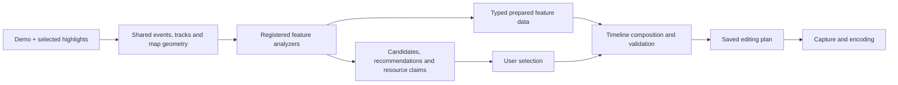

# Editing preview (unreleased)

## Flow

Select highlights, open Export, then choose **Analyze editing opportunities**.
Ordinary export remains available without analysis. Analysis reads the demo and
installed map geometry; it does not launch CS2 or HLAE. Missing geometry is shown
as unavailable team-push analysis, not as evidence that no push occurred.

The result distinguishes availability from recommendation. Every supported gun
kill with a valid enemy camera can be selected, including kills below the
automatic recommendation threshold. Recommendations retain the reciprocal-combat
rule. Camera eligibility, round boundaries, and required playback time still
apply. Utility stories and team pushes are currently selected per highlight;
enemy replays are selected per kill. Conflicting alternatives replace each other.
The UI shows one notice about increased length and quality under a size limit.

Results are grouped into collapsible highlights with a selected/available count.
The first highlight starts expanded. Enemy replays share one heading and use
compact selectable rows; collapsing a highlight preserves its selections.
Highlights without candidates remain visible in a mixed result as unavailable.

Changing highlights or the combat-trimming mode invalidates the current UI
selection. Analysis is cached by version, demo path/size/modification time,
parse generation, selected highlight definitions, and trimming choices. Encoding
settings do not invalidate it. Opening the dialog reads matching cached results
without starting analysis. Analyze again removes the old cache and recomputes it;
a failed recomputation leaves no old result to reload.

Queueing composes a plan from cached feature opportunities and cameras, validates the selection,
and saves `editing-plan.json` beside the job. Export consumes that snapshot without
rerunning event or geometry analysis. Clearing the cache cannot change queued
work. Changed demo input and missing or invalid plans fail explicitly.

## Pipeline ownership

- `render/demo_data.rs` acquires shared facts. `editing/context.rs` loads the demo
  bytes once, parses events, and optionally supplies sampled positions and static
  map geometry. No game process is started. Missing spatial data only disables
  features requiring it.
- `editing/features/mod.rs` is the registration point and `Feature` contract.
  Each feature owns discovery, eligibility, recommendations, its serialized
  prepared data, composition, and validation. Domain calculations remain in the
  corresponding opening, perspectives, utility, and team-push modules, alongside
  their existing camera scheduling adapters.
- Detection resolves utility causality, combat scores and eligibility, living
  intervals for openings, and team-push cameras once. `Composition` has no events,
  parser, file handles, or game tools. It only positions prepared opportunities
  against the evolving timeline; grouping or collision checks at this stage are
  composition, not scene detection.
- `editing.rs` coordinates the registry, resource conflicts, duration estimates,
  feasibility checks, and user selection. It does not compare named feature pairs.
  Features claim an introduction slot or a player's perspective interval. Priority
  chooses the default when those resources overlap; users can choose either.
  Composition also validates individual candidates, pairs, and defaults.
- Compilation phases are explicit: expand coverage, construct stories, insert
  replays, then prepend introductions. Each selected feature validates its result
  after composition, so another edit cannot silently remove it. The renderer's
  clip/camera arrays are checked for alignment at the boundary.
- `engine/editing.rs` owns cache identity, freshness, reanalysis and immutable job
  snapshots. Both interactive and non-interactive requests use the same pipeline.
  Render options for non-interactive requests only select registry entries.

To add a feature, implement its analyzer and `Feature` contract in a new feature
module, register it, and add its typed serialized payload and UI kind/labels.
Declare existing resource claims and the compilation phase it needs. New rule
conditions belong inside that feature; do not add branches to the orchestrator.
A new data source or camera primitive may require extending those shared contracts.
No dynamic plugin framework or generic predicate engine is involved.

This is an unreleased schema replacement. Version 2 invalidates old analysis keys;
there is no reader or conversion for the old events-based cache. Reanalyze to
create new results. Old queued editing jobs also require fresh analysis.

Regression verification covers 64 selection combinations across three local demo
jobs, comparing candidates, recommendations, conflicts and exact shot plans before
and after the refactor. Synthetic tests cover team push plus combat, competing
introductions, user-selected non-recommended kills, serialized analysis roundtrips,
and missing spatial data. Private demo characterization is opt-in via
`DEMODESK_PIPELINE_JOBS` (semicolon-separated job JSON paths) and
`DEMODESK_PIPELINE_OUTPUT` (a new output directory), then
`cargo test -p demodesk-core --lib characterize_editing_pipeline -- --ignored --nocapture`.

## Recording

All capture passes of a job share one owned CS2 process. Each pass reloads its
schedule and demo; encoder preset names are unique to the output directory so
HLAE cannot reuse an earlier pass's file path. Per-seek audio clearing, three
seconds of preroll, and the wall-time settling gate are unchanged. Failure and
early return still drain the owned process tree.

Local comparison on one reported AV1 clip, with identical recording settings and
size recompression disabled: separate processes took 148.22 seconds; shared
process took 118.46 seconds (about 20% less). Three launches became one. This is
one local measurement, not a general speed guarantee. Enemy-view frames were
checked in the raw captures. Offline candidate analysis for the same clip took
7.58 seconds and found four available enemy replays, two recommended, plus an
opening camera.

A second native check selected all three available enemy replays plus the opening
camera on the other reported clip. Four capture passes shared one CS2 launch and
used the saved plan without reanalysis. All three enemy viewpoints were checked;
the complete 20 MiB export produced a 30.02-second, 19.47 MiB video.

## Checks

- `npm run build`
- `npm run test:ui` (requires the documented Playwright runtime)
- `cargo test -p demodesk-core --lib`
- `cargo check -p demodesk`

The opt-in `render::experiments::reproduce_editing_job` test writes into a new
directory and accepts `DEMODESK_REPRO_ANALYZE`, `DEMODESK_REPRO_ANALYSIS_ONLY`,
`DEMODESK_REPRO_ALL_COMBAT`, and `DEMODESK_REPRO_SEPARATE_PROCESS` for local
comparison. These are test-only controls, not production settings.
